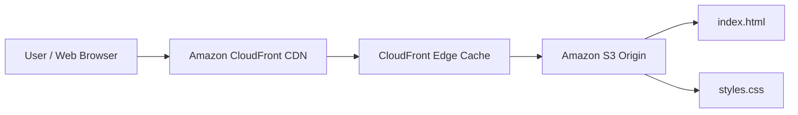

# Deploying a Scalable Static Website with a CDN

A cloud computing internship project that demonstrates how to host a static website on **Amazon S3** and deliver it globally through **Amazon CloudFront** for improved performance, availability, and reduced latency.

## Live Demo

**CloudFront URL:** https://d2w6na9g7obu6s.cloudfront.net

## Project Overview

This project deploys a lightweight responsive website using AWS managed services. Amazon S3 acts as the origin for the static website files, while Amazon CloudFront works as the Content Delivery Network (CDN), caching content at edge locations and serving it closer to users.

### Objectives

- Host a static HTML/CSS website in the cloud.
- Use Amazon S3 as the website origin/storage layer.
- Distribute the website through Amazon CloudFront.
- Reduce content-delivery latency using CDN edge caching.
- Demonstrate a simple, scalable AWS static-site architecture.

## Architecture



**Request flow:** `User → CloudFront Edge Location → Amazon S3 Origin`

## AWS Services Used

| Service | Purpose |
|---|---|
| **Amazon S3** | Stores the static website files such as HTML and CSS. |
| **Amazon CloudFront** | Distributes and caches website content through AWS edge locations. |

## Tech Stack

- HTML5
- CSS3
- Amazon Web Services (AWS)
- Amazon S3
- Amazon CloudFront

## Repository Structure

```text
.
├── index.html
├── styles.css
├── README.md
└── docs/
    ├── Cloud_Computing_Internship_Project_Report.pdf
    └── Static_Website_CDN_Presentation.pptx
```

## How It Works

1. The user requests the website through the CloudFront distribution URL.
2. CloudFront checks whether the requested object is available in its edge cache.
3. If the object is cached, CloudFront returns it directly to the user.
4. If it is not cached, CloudFront retrieves the object from the Amazon S3 origin.
5. The object can then be cached at the edge for subsequent requests, reducing latency for future visitors.

## Deployment Steps

### 1. Create an S3 bucket

Create an Amazon S3 bucket to store the static website assets.

### 2. Upload the website files

Upload:

```text
index.html
styles.css
```

Make sure the files are available to the CloudFront origin using the access configuration chosen for your deployment.

### 3. Create a CloudFront distribution

- Create a new Amazon CloudFront distribution.
- Configure the S3 bucket as the origin.
- Set `index.html` as the default root object.
- Configure the required origin access and cache behavior settings.

### 4. Deploy and test

After the distribution is deployed, open the CloudFront domain in a browser and verify that the site loads correctly.

## Features

- Responsive web design
- Cloud-based static hosting
- Global content delivery
- CDN edge caching
- Reduced latency for geographically distributed users
- Simple architecture with minimal infrastructure management

## What I Learned

Through this project, I gained practical experience with:

- Static website deployment on AWS
- Amazon S3 object storage
- Amazon CloudFront distributions
- CDN concepts and edge caching
- Origin-to-edge content delivery
- Basic cloud architecture and deployment workflow

## Project Documentation

Additional internship documentation is available in the [`docs`](./docs) directory:

- Cloud Computing Internship Project Report
- Static Website CDN Presentation

## Possible Improvements

Future improvements could include:

- Adding a custom domain using Amazon Route 53 or another DNS provider
- Enabling HTTPS with a custom domain using AWS Certificate Manager
- Restricting direct S3 access with CloudFront Origin Access Control (OAC)
- Adding cache-control headers and optimized cache policies
- Automating deployment with GitHub Actions or AWS CI/CD services
- Adding infrastructure as code using AWS CloudFormation or Terraform

## Author

Developed as part of a **Cloud Computing Internship Project** to demonstrate static website hosting and global content delivery with AWS.

## License

This repository is intended for educational and portfolio purposes.
